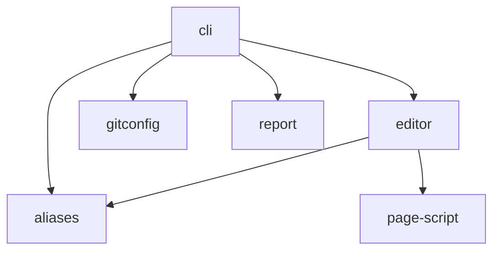

# src

The modules of the tool, for whoever changes them: their layers, which of
them touch files, and the imports between them.

## Layers

A module imports from this directory only modules of the layers below its
own; `tests/layers.test.js` fails otherwise. Lowest layer first:

| Layer        | Modules                               | Does                                                                                                                                                  |
| ------------ | ------------------------------------- | ----------------------------------------------------------------------------------------------------------------------------------------------------- |
| Basics       | `aliases`, `gitconfig`, `page-script` | Analyses a set of aliases and edits it; turns git's report of a gitconfig into aliases and their comments; the editor page's behaviour in the browser |
| Output       | `editor`, `report`                    | Renders the editor page as HTML; writes the summary lines of `stats`                                                                                  |
| Command line | `cli`                                 | Parses the arguments, reads the aliases through git, prints the summary or writes the page                                                            |

The editor page runs the functions of `aliases` too: `editor` embeds their
source, so they import nothing and call one another only by name.

## Files

Only `cli` reads or writes files and runs git. Every other module takes
data and returns data, so the tests call them without files on disk.

## Imports

Run `node scripts/module-diagram.js` after changing an import;
`npm run check` fails while the diagram below differs from the code.

<!-- module diagram: generated by scripts/module-diagram.js -->

<!-- end of module diagram -->
